# 🛡️ DataOps Guardian

### Automated Data Operations, CI/CD, Cloud Deployment and Backup Management

DataOps Guardian is a hands-on DevOps and cloud operations project designed to demonstrate automated testing, application deployment, cloud infrastructure management, monitoring and data backup.

The project combines Python, Docker, GitHub Actions, AWS, Elasticsearch and Kibana to build a containerized application environment with automated CI/CD, HTTPS access and Elasticsearch snapshot backups stored in Amazon S3.

### Key Features

- Automated CI/CD using GitHub Actions.
- Docker-based application deployment.
- AWS EC2 cloud infrastructure.
- Elasticsearch and Kibana integration.
- Nginx reverse proxy and HTTPS.
- Private Amazon S3 backup storage.
- Automated Elasticsearch snapshot lifecycle policy.
- AWS IAM role-based access.
- Application health checks.
- Kubernetes and Helm deployment validation.

---

# 🏗️ 1. System Architecture

The architecture illustrates how the application, CI/CD pipeline, AWS infrastructure and data services work together.

**Architecture components:**

- **GitHub:** Source code management and version control.
- **GitHub Actions:** Automated testing and deployment.
- **AWS EC2:** Hosts the application environment.
- **Docker Compose:** Manages application containers.
- **Nginx:** Reverse proxy for incoming web traffic.
- **Elasticsearch:** Data indexing and storage.
- **Kibana:** Elasticsearch data exploration.
- **Amazon S3:** Stores snapshot backups.
- **AWS IAM:** Manages access permissions.

### Architecture Diagram

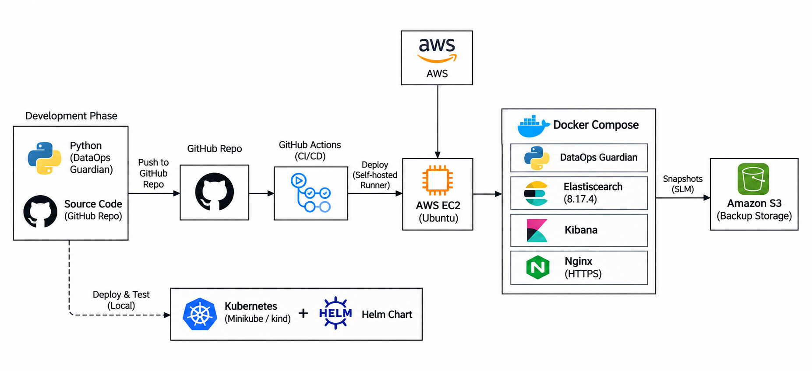

---

# 🧰 2. Technology Stack

The project uses modern DevOps, cloud computing and data technologies.

| Technology | Purpose |
|---|---|
| Python | Application development and automation |
| pytest | Automated testing |
| Ruff | Code quality and linting |
| Git and GitHub | Version control |
| GitHub Actions | CI/CD automation |
| Docker | Containerization |
| Docker Compose | Container management |
| Elasticsearch 8.17.4 | Search and data storage |
| Kibana 8.17.4 | Data exploration |
| AWS EC2 | Cloud computing |
| Amazon S3 | Backup storage |
| AWS IAM | Access management |
| Nginx | Reverse proxy |
| DuckDNS | Domain configuration |
| Let's Encrypt | HTTPS certificates |
| Certbot | Certificate renewal |
| Kubernetes and Helm | Deployment configuration and validation |

### DevOps Technology Stack

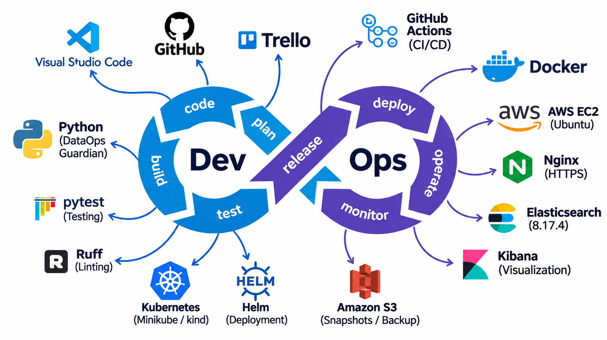

---

# ⚙️ 3. CI/CD Pipeline – GitHub Actions

GitHub Actions automates the project's software testing and deployment workflow.

**Pipeline process:**

1. Developer pushes code to GitHub.
2. GitHub Actions triggers the workflow.
3. Python dependencies are installed.
4. Ruff performs code quality checks.
5. pytest executes automated tests.
6. Docker images are built.
7. The deployment workflow uses a self-hosted GitHub Actions runner on EC2.
8. Deployment and application health checks are performed.

Kubernetes and Helm validation are also included in the project's testing workflows.

### CI/CD Workflow

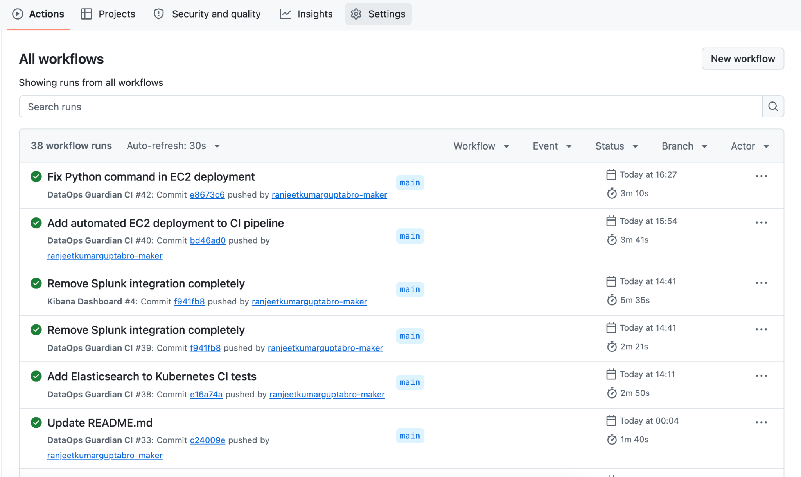

---

# ☁️ 4. AWS EC2 – Cloud Infrastructure

Amazon EC2 provides the cloud computing environment where DataOps Guardian runs.

The EC2 instance uses Ubuntu and hosts the Docker-based application environment.

**Main responsibilities:**

- Runs the Python application.
- Hosts Elasticsearch and Kibana containers.
- Runs Docker Compose services.
- Hosts the self-hosted GitHub Actions runner.
- Runs Nginx as a reverse proxy.
- Connects to Amazon S3 through an attached IAM role.

**AWS Region:** `eu-north-1` (Stockholm).

### EC2 Instance

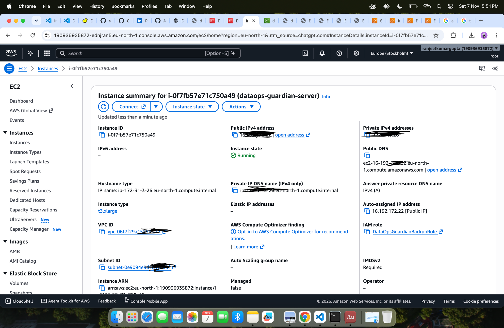

---

# 🔐 5. AWS IAM – Identity and Access Management

AWS IAM manages permissions for accessing AWS resources.

The project uses an EC2 instance role named `DataOpsGuardianBackupRole`.

This allows the EC2 environment to access Amazon S3 without storing permanent AWS access keys on the server.

**Configured permissions include:**

- Listing the backup bucket.
- Reading bucket location information.
- Uploading snapshot objects.
- Reading and deleting snapshot objects.
- Managing multipart uploads.

### IAM Role Configuration

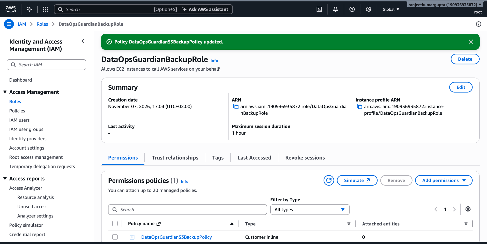

---

# 🛡️ 6. AWS Security Groups

EC2 security groups control inbound network access to the instance.

The configured rules allow required web traffic while keeping internal services private.

| Port | Service | Purpose |
|---|---|---|
| 22 | SSH | Server administration |
| 80 | HTTP | Web traffic |
| 443 | HTTPS | Secure web traffic |

Elasticsearch and Kibana management ports are not intended to be publicly exposed.

### Inbound Security Rules

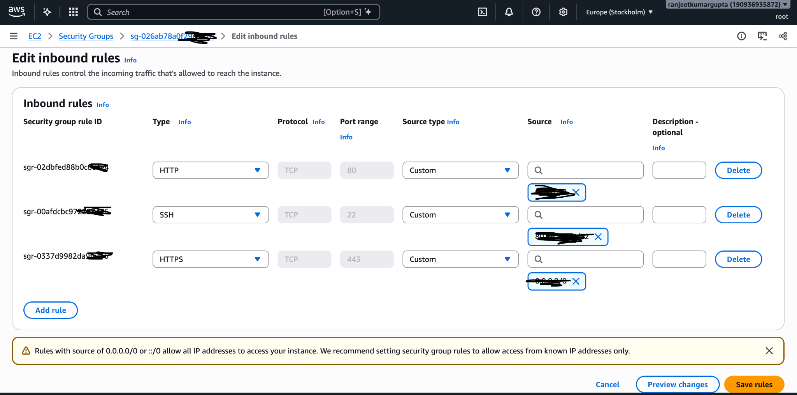

---

# 🐳 7. Docker and Docker Compose

Docker provides a consistent environment for running the application and its supporting services.

Docker Compose manages the services together.

**Main containers:**

- DataOps Guardian Python application.
- Elasticsearch 8.17.4.
- Kibana 8.17.4.

Elasticsearch data is stored in a named Docker volume to preserve data across container replacement.

---

# 🔎 8. Elasticsearch

Elasticsearch is the search and data storage engine used by the project.

It stores application-related report data and provides APIs for health checks and data operations.

**Configuration:**

- Version: `8.17.4`.
- Single-node deployment.
- Docker-based service.
- Persistent named volume.
- Cluster health monitoring.
- S3 snapshot repository integration.

The Elasticsearch API is bound to localhost on the EC2 host rather than exposed publicly.

---

# 📊 9. Kibana – Data Exploration

Kibana provides a graphical interface for working with Elasticsearch.

It can be used to:

- Explore Elasticsearch indices.
- Inspect stored documents.
- Query application data.
- Create and explore visualizations and dashboards.

Kibana runs as a Docker service alongside Elasticsearch. Its management interface is kept private.

---

# ❤️ 10. Application Health Checks

The Python application exposes a health endpoint to verify that the service is responding.

**Public endpoint:**

https://dataops-guardian.duckdns.org/health

Expected response:

```json
{
  "service": "dataops-guardian",
  "status": "healthy"
}
```

The deployed endpoint was verified to return HTTP `200`.

### Application Health Check

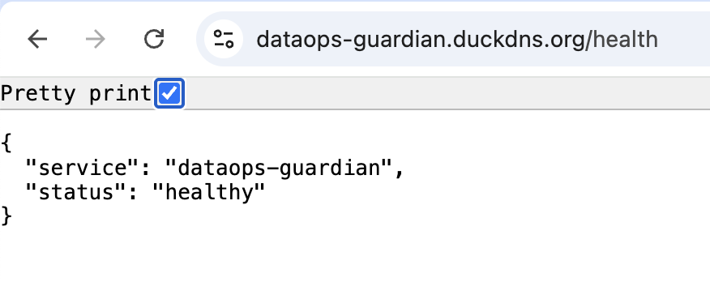

---

# 🌐 11. Nginx, DNS and HTTPS

Nginx acts as a reverse proxy between public web traffic and the Python application.

The application listens locally on port `8080`, while Nginx forwards incoming requests.

**Configuration includes:**

- DuckDNS domain configuration.
- Nginx reverse proxy.
- Let's Encrypt TLS certificate.
- Certbot certificate renewal.
- HTTPS application access.

The Certbot renewal dry run completed successfully.

---

# 🪣 12. Amazon S3 – Backup Storage

Amazon S3 is used to store Elasticsearch snapshot backups.

**Bucket configuration:**

| Setting | Value |
|---|---|
| Bucket | `dg-backups-2026-1107-58291` |
| Region | `eu-north-1` |
| Access | Private |
| Block Public Access | Enabled |
| Encryption | S3 server-side encryption |
| Snapshot repository | `dataops-s3-backups` |
| Base path | `dataops-guardian` |

The EC2 IAM role provides access to the bucket without requiring permanent AWS credentials.

### S3 Backup Bucket

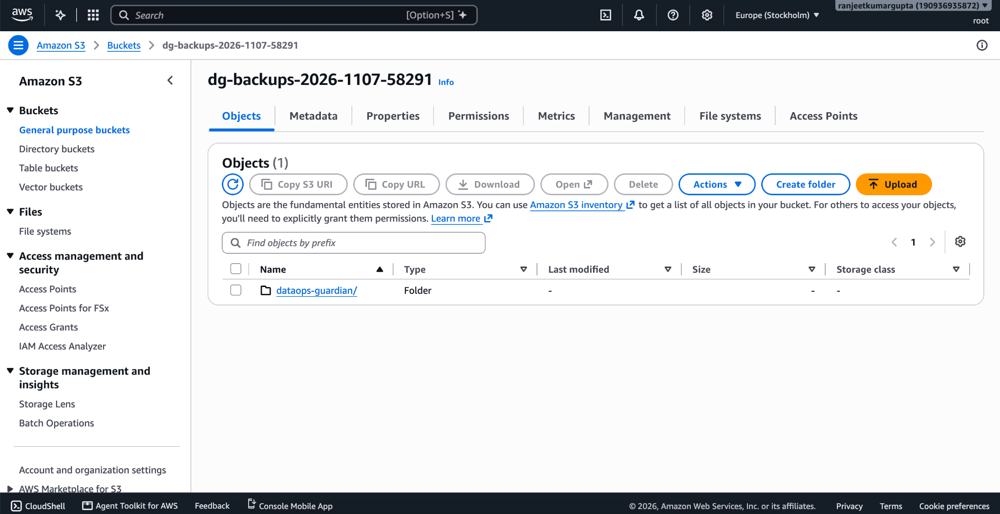

---

# 💾 13. Elasticsearch Snapshot Backups

Elasticsearch snapshots are configured to back up the `guardian-reports` index to Amazon S3.

The first manual snapshot was named:

`guardian-first-backup`

### First Snapshot Results

| Metric | Result |
|---|---|
| Snapshot status | SUCCESS |
| Total shards | 11 |
| Successful shards | 11 |
| Failed shards | 0 |

The snapshot objects were verified in the configured S3 bucket.

### Backup Verification

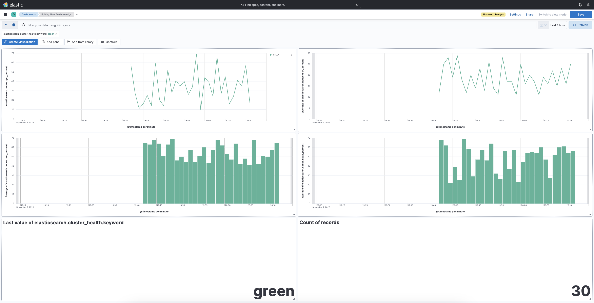

---

# ⏰ 14. Snapshot Lifecycle Management – SLM

Elasticsearch Snapshot Lifecycle Management automates snapshot scheduling and retention.

The configured policy is named `daily-snapshots`.

| Setting | Configuration |
|---|---|
| Policy | `daily-snapshots` |
| Schedule | Daily at 02:00 UTC |
| Repository | `dataops-s3-backups` |
| Included index | `guardian-reports` |
| Snapshot naming | `daily-snapshot-{now/d}` |
| Expiration | 30 days |
| Minimum snapshots | 7 |
| Maximum snapshots | 30 |

The retention policy is designed to maintain backup history while automatically managing older snapshots.

The policy configuration has been created. Its first scheduled execution should be verified before claiming recurring backups have been tested.

### SLM Backup Policy

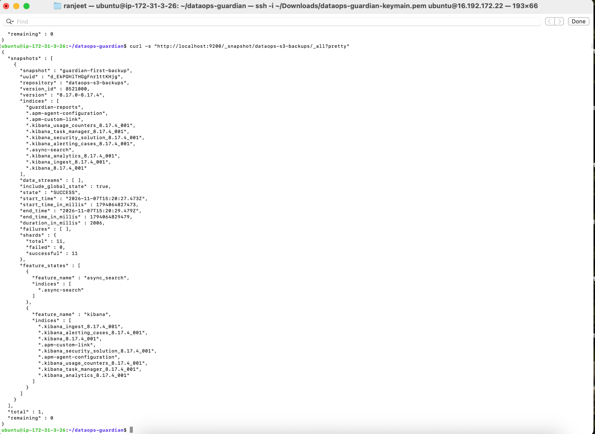

### Daily Backup Configuration

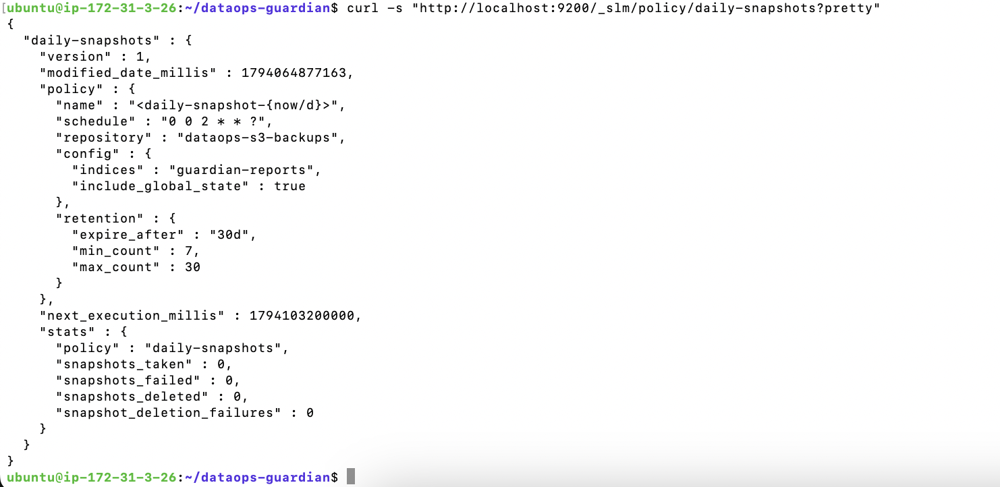

---

# ♻️ 15. Backup and Restore Strategy

A backup is only useful if the data can be restored.

The restore procedure uses a separate test index:

`guardian-reports-restore-test`

This avoids overwriting the original production index.

The restore validation should check:

1. The snapshot is accessible from S3.
2. Elasticsearch successfully restores the index.
3. The restored index becomes available.
4. The restored document count matches the original.
5. The production index remains unchanged.

**Restore testing:** Record the final result after completing the separate-index restore test.

---

# 🖥️ 16. Development Environment

The project was developed and managed using Visual Studio Code and GitHub Codespaces.

The development workflow includes Python development, Docker configuration, automated tests, Git version control and cloud deployment configuration.

### Development Environment

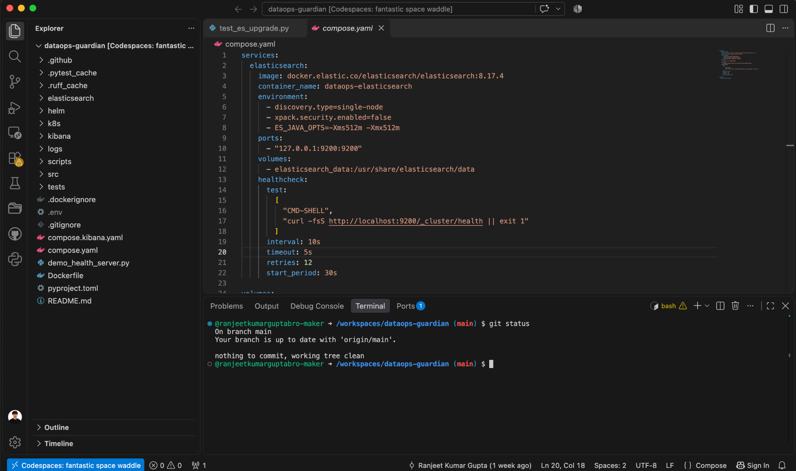

---

# 📁 17. Project Structure

```text
dataops-guardian/
│
├── .github/
│   └── workflows/       # GitHub Actions workflows
│
├── docs/
│   └── images/          # Screenshots and architecture diagrams
│
├── src/
│   └── dataguardian/    # Python application
│
├── tests/               # Automated tests
├── scripts/             # Helper and operational scripts
├── helm/                # Helm chart
├── k8s/                 # Kubernetes resources
├── elasticsearch/       # Elasticsearch configuration
│
├── compose.yaml         # Docker Compose configuration
├── Dockerfile           # Application image
├── pyproject.toml       # Python project configuration
└── README.md
```

---

# 🚀 18. Run Locally

### Clone the repository

```bash
git clone https://github.com/ranjeetkumarguptabro-maker/dataops-guardian.git
cd dataops-guardian
```

### Create a virtual environment

```bash
python3 -m venv .venv
source .venv/bin/activate
```

### Install dependencies

```bash
python -m pip install --upgrade pip
python -m pip install -e ".[dev]"
```

### Run code quality checks

```bash
ruff check .
ruff format --check .
```

### Run automated tests

```bash
python -m pytest -v
```

### Start Docker Compose

```bash
docker compose config
docker compose up -d
docker compose ps
```

### Stop services

```bash
docker compose down
```

Avoid `docker compose down -v` unless you intentionally want to delete named volumes and their persistent data.

---

# 🔒 19. Security Practices

- Private S3 bucket with Block Public Access enabled.
- IAM instance role instead of permanent AWS access keys.
- Restricted SSH access.
- Elasticsearch API bound to localhost.
- Kibana management interface kept private.
- HTTPS through Nginx and Let's Encrypt.
- Persistent Elasticsearch data volume.
- No private keys, passwords or secret tokens committed to GitHub.

---

# 🎯 20. Project Learning Outcomes

This project demonstrates practical experience with:

- Python automation and testing.
- Git and GitHub.
- GitHub Actions CI/CD.
- Docker and Docker Compose.
- AWS EC2 deployment.
- AWS IAM permissions.
- Amazon S3 backup storage.
- Elasticsearch and Kibana.
- Nginx reverse proxy.
- HTTPS and certificate renewal.
- Elasticsearch snapshots and SLM.
- Kubernetes and Helm validation.

---

# 👨‍💻 Project Repository

**DataOps Guardian**

GitHub: https://github.com/ranjeetkumarguptabro-maker/dataops-guardian

A hands-on DevOps and cloud operations project focused on automation, reliable deployment, data services and backup management.